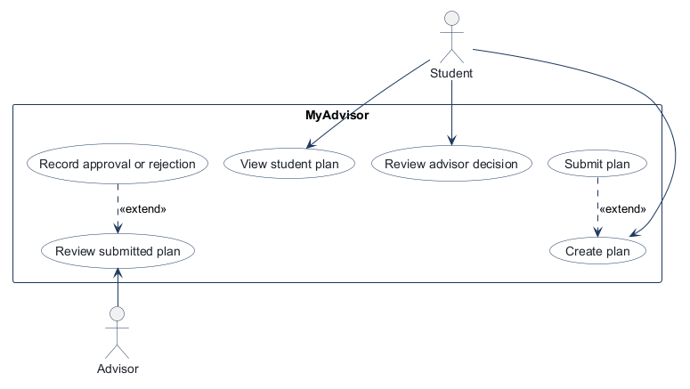
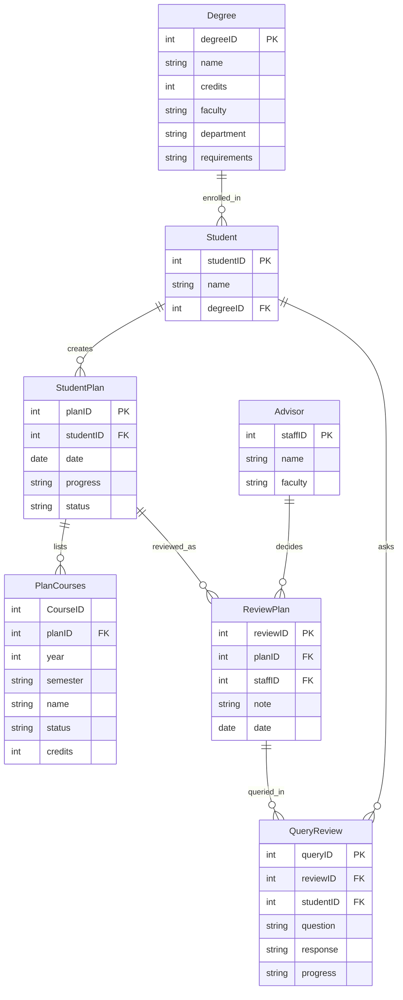
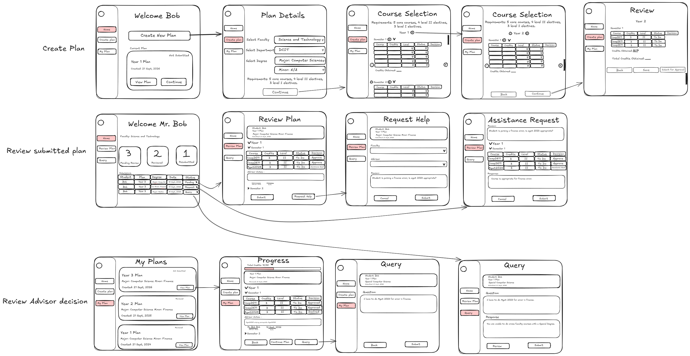

# COMP 3613 Assignment 1

Draft this file with the Guide. **Update it after every phase milestone** before you pause. The use-case diagram is a UML PNG at `docs/diagrams/use-case.png`, linked from this file as `diagrams/use-case.png` (path relative to `docs/report.md`). The model diagram is Mermaid. **Embed wireframe images** as `wireframes/<file>` (files live in `docs/wireframes/`).

Do not put your student ID in this file if you will commit it. The PDF cover adds your name and ID at export time.

## Assigned project

**MyAdvisor** — students track degree progress, plan semester course selections, and obtain approval from an administrator / advisor.

## Three workflows

### 1. Create plan (Student)

### 2. Review submitted plan (Advisor)

### 3. Review advisor decision (Student)

## Use case diagram

Phase 2 notes (student-owned):

- **«extend»:** Record approval or rejection «extend»s Review submitted plan (Advisor). Submit plan «extend»s Create plan (Student).
- **Actors:** View student plan is Student-only. Advisor starts Review submitted plan (not View student plan).
- **Gap reconsider:** Advisor gets a plan via Submit plan as an extension of Create plan.
- Login/session stays starter supporting behaviour, not a named use case.

## Model diagram

First draft from student-named entities and properties. Update this section in Phase 5 when polish revises the model, and note what changed.

Student-owned relationships: StudentPlan to PlanCourses is one-to-many; StudentPlan to ReviewPlan is one-to-many (a rejected plan can get a later decision as a new ReviewPlan, not an overwrite). Assumed from listed FKs: Degree to Student, Student to StudentPlan, Advisor to ReviewPlan, ReviewPlan to QueryReview, Student to QueryReview. No separate Course entity; `CourseID` stays on PlanCourses. Degree `requirements` is a property. No direct Student–Advisor assignment.

Phase 4 model revisions (student-accepted from wireframes): `Degree.department`; `PlanCourses.credits`; `StudentPlan.status` (`not submitted` / `pending` / `reviewed`). `ReviewPlan.decision` is not used for the whole plan — approve/reject is per `PlanCourses.status`; advisor Submit sets the plan to `reviewed`. Not applied: `PlanCourses.type`, `PlanCourses.note`. Request Help stays a review workflow (save progress, faculty → advisor, note); the helping advisor does not become the student’s advisor.

## Wireframes

Student-crafted set: one PNG covering Create plan, Review submitted plan, and Review advisor decision.

### MyAdvisor

<!-- student-build:wireframe-coverage
use_case: Create plan
image: docs/wireframes/MyAdvisor.png
covered: yes
-->

<!-- student-build:wireframe-coverage
use_case: Submit plan
image: docs/wireframes/MyAdvisor.png
covered: yes
-->

<!-- student-build:wireframe-coverage
use_case: View student plan
image: docs/wireframes/MyAdvisor.png
covered: yes
-->

<!-- student-build:wireframe-coverage
use_case: Review advisor decision
image: docs/wireframes/MyAdvisor.png
covered: yes
-->

<!-- student-build:wireframe-coverage
use_case: Review submitted plan
image: docs/wireframes/MyAdvisor.png
covered: yes
-->

<!-- student-build:wireframe-coverage
use_case: Record approval or rejection
image: docs/wireframes/MyAdvisor.png
covered: yes
-->

Coverage notes: Create plan is Welcome → Plan Details → Course Selection → Review (`Save` / `Submit for Approval`). Review submitted plan is advisor home → Review Plan; approve/reject is per course, then Submit sets the plan to `reviewed`. Request Help saves progress, then faculty → advisor → note; the other advisor only assists. Review advisor decision is My Plans (`not submitted` / `pending` / `reviewed`) → view a reviewed plan (courses, per-course decisions and notes) → Query if the student is confused. Incomplete-but-fixable: Review Plan still shows plan-level Approve/Reject chrome; Progress still shows Confirm Plan; My Plans mock labels do not match the status rule above. No redraw.

`python manage.py report` also embeds any PNG/JPG still missing from `docs/wireframes/`.

## Theming

Student preferences (Phase 5):

- **Colors:** teal, white, grey
- **Type:** modern sans-serif
- **Tone:** modern academic
- **Logo / wordmark:** MyAdvisor

Applied in `app/static/css/app.css` tokens (`--brand-accent` teal, `--brand-surface` white, `--brand-muted` / ink greys, Source Sans 3). Public **landing (`/`)**, **login**, and **register** use the MyAdvisor wordmark and academic copy. Authenticated shell wordmark matches. Starter FastStarter placeholder copy removed from those screens; `/config` and auth are kept.

## Implementation notes

One named workflow at a time. Include verify notes and polish / model revisions (Phase 5). Do not treat the first build as final.

### Create plan (Student)

Student linked as a **separate Student table with FK to User** (login stays on User). A **StudentPlan** row is stored when they click **Save** or **Submit** on Review (Plan Details / Course Selection stay in-progress until then).

<!-- student-build:code-check
workflow: Create plan
form: choice
layer: other
architecture_ok: yes
implement_confidence: 0.82
passed: yes
note: Persist StudentPlan on Review Save/Submit, not at Welcome or Plan Details Continue.
-->

<!-- student-build:code-check
workflow: Create plan
form: choice
layer: model
architecture_ok: yes
implement_confidence: 0.82
passed: yes
note: Separate Student table, FK to User (not same-id or fields on User).
-->

<!-- student-build:code-check
workflow: Create plan
form: snippet
layer: model
architecture_ok: yes
implement_confidence: 0.78
passed: partial
note: Student name, degreeID, user_id present; User FK corrected from user.user_id to user.id.
-->

<!-- student-build:code-check
workflow: Create plan
form: snippet
layer: router
architecture_ok: yes
implement_confidence: 0.74
passed: partial
note: Called a service, no SQL in route; SessionDep has no get_repository/get_service — wired PlanRepository(db) + PlanService.
-->

## Deployed app

Phase 6. Public Render URL (not localhost). Markers open this to mark the three workflows.

https://

## Logins

Every account a marker needs, including extra users you added. Starter accounts:

- bob / bobpass — regular user
- admin / adminpass — admin

## YouTube URL

## Session transcripts

Filled when the Guide builds the report: the agent writes each Guide chat to `docs/transcripts/<slug>.md` (Copilot Agent, Cursor, or OpenCode). `python manage.py report` packages them. Do not paste chats here during the build.

## Competency (student-judge)

Filled when the report is built. Guide runs student-judge, writes `docs/judge.md`, and export appends the scorecard here.

## Skill integrity

Filled by `python manage.py report`. Do not edit the course skills.
