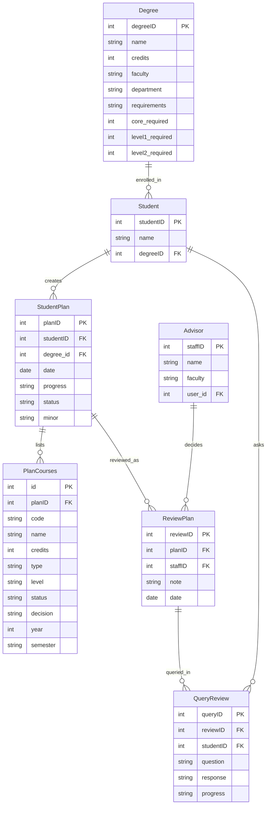

# COMP 3613 Assignment 1

Draft this file with the Guide. **Update it after every phase milestone** before you pause. The use-case diagram is a UML PNG at `docs/diagrams/use-case.png`, linked from this file as `diagrams/use-case.png` (path relative to `docs/report.md`). The model diagram is Mermaid. **Embed wireframe images** as `wireframes/<file>` (files live in `docs/wireframes/`).

Do not put your student ID in this file if you will commit it. The PDF cover adds your name and ID at export time.

## Assigned project

**MyAdvisor** — students track degree progress, plan semester course selections, and obtain approval from an administrator / advisor.

## Three workflows

### 1. Create plan (Student)

### 2. Review submitted plan (Advisor)

### 3. Review advisor decision (Student)

## Use case diagram

Phase 2 notes (student-owned):

- **«extend»:** Record approval or rejection «extend»s Review submitted plan (Advisor). Submit plan «extend»s Create plan (Student).
- **Actors:** View student plan is Student-only. Advisor starts Review submitted plan (not View student plan).
- **Gap reconsider:** Advisor gets a plan via Submit plan as an extension of Create plan.
- Login/session stays starter supporting behaviour, not a named use case.

## Model diagram

First draft from student-named entities and properties. Update this section in Phase 5 when polish revises the model, and note what changed.

Student-owned relationships: StudentPlan to PlanCourses is one-to-many; StudentPlan to ReviewPlan is one-to-many (a rejected plan can get a later decision as a new ReviewPlan, not an overwrite). Assumed from listed FKs: Degree to Student, Student to StudentPlan, Advisor to ReviewPlan, ReviewPlan to QueryReview, Student to QueryReview. No separate Course entity; `CourseID` stays on PlanCourses. Degree `requirements` is a property. No direct Student–Advisor assignment.

Phase 4 model revisions (student-accepted from wireframes): `Degree.department`; `PlanCourses.credits`; `StudentPlan.status` (`not submitted` / `pending` / `reviewed`). `ReviewPlan.decision` is not used for the whole plan — approve/reject is per `PlanCourses.status`; advisor Submit sets the plan to `reviewed`. Not applied: `PlanCourses.type`, `PlanCourses.note`. Request Help stays a review workflow (save progress, faculty → advisor, note); the helping advisor does not become the student’s advisor.

Phase 5 redesign (student-accepted, Create plan): students **type** course rows instead of picking from a catalog — `PlanCourses.CourseID` (int) becomes `code` (string, e.g. COMP 2601); added `level` (Level I / II / III select, per the wireframe's Level column); `status` is now the **student's** course status (`To Do` / `Passed` / `Fail`) and a new `decision` column holds the **advisor's** per-course decision (`Approve` / `Reject` / `Additional Help`, used by workflow 2). Added `StudentPlan.minor` — originally a select off the degree list, then changed by the student to **free text** typed on Plan Details. Levels: `Course ID` on the ERD is the typed code, not a foreign key.

Second redesign pass (student-accepted): `PlanCourses.type` (`Core` / `Elective` / `Minor`) added as the **Course type** column on Course Selection — needed for the minor rule (minor entered ⇒ Level II requirement drops by 2 and 2 minor courses are added). Credits Obtained per semester/year counts only courses marked **Passed**; shows **N/A** when nothing in that group is passed. `StudentPlan.progress` stays unused; semester labels are free-form strings (`1`, `2`, or `Summer`) stored per year in the session draft.

Review "courses still needed" (student-accepted, option A): `Degree` gains numeric `core_required` / `level1_required` / `level2_required` (seeded 3 / 3 / 4 to match the requirements text). `PlanService.requirements_summary` prints one line per category — `Core courses`, `Level I electives`, `Level II electives`, plus `Minor courses` (2) only when a minor is typed — counting only **Passed** rows, classified by Course type first (Core/Minor) then by Level for electives. A typed minor reduces the Level II requirement by 2. `MINOR_REQUIRED = 2`, `MINOR_LEVEL_II_REDUCTION = 2` live on the service.

Workflow 2 model revisions (student-accepted): **`Advisor.user_id` FK to `user.id`** — the ERD had no way to link an advisor to a login, so `Advisor` now mirrors the `Student` pattern and advisors sign in with their own account (`role = "advisor"`, seeded `advisor/advisorpass` for Science and Technology and `advisor2/advisor2pass` for Social Sciences). The three advisor counters are **derived from `ReviewPlan` history**, not new statuses: over plans with `status = pending`, 0 review rows = Pending Review, exactly 1 = Received, 2 or more = Resubmitted (a review row is created when an advisor opens a pending plan; Submit closes the review and sets the plan to `reviewed`).

**`StudentPlan.degree_id`** (student-accepted, Phase 5 revision): the degree was stored only on `Student`, so choosing a different major on a new plan rewrote the student's programme and — because the advisor queue joined `Student → Degree` — moved **every** one of that student's plans to another faculty, including plans already submitted or reviewed. The degree now belongs to the plan: `StudentPlan.degree_id` FK to `Degree`, the advisor queue joins `StudentPlan → Degree`, and `Student.degreeID` is set once (the student's enrolled programme, from their first plan) and never rewritten afterwards.

## Wireframes

Student-crafted set: one PNG covering Create plan, Review submitted plan, and Review advisor decision.

### MyAdvisor

<!-- student-build:wireframe-coverage
use_case: Create plan
image: docs/wireframes/MyAdvisor.png
covered: yes
-->

<!-- student-build:wireframe-coverage
use_case: Submit plan
image: docs/wireframes/MyAdvisor.png
covered: yes
-->

<!-- student-build:wireframe-coverage
use_case: View student plan
image: docs/wireframes/MyAdvisor.png
covered: yes
-->

<!-- student-build:wireframe-coverage
use_case: Review advisor decision
image: docs/wireframes/MyAdvisor.png
covered: yes
-->

<!-- student-build:wireframe-coverage
use_case: Review submitted plan
image: docs/wireframes/MyAdvisor.png
covered: yes
-->

<!-- student-build:wireframe-coverage
use_case: Record approval or rejection
image: docs/wireframes/MyAdvisor.png
covered: yes
-->

Coverage notes: Create plan is Welcome → Plan Details → Course Selection → Review (`Save` / `Submit for Approval`). Review submitted plan is advisor home → Review Plan; approve/reject is per course, then Submit sets the plan to `reviewed`. Request Help saves progress, then faculty → advisor → note; the other advisor only assists. Review advisor decision is My Plans (`not submitted` / `pending` / `reviewed`) → view a reviewed plan (courses, per-course decisions and notes) → Query if the student is confused. Incomplete-but-fixable: Review Plan still shows plan-level Approve/Reject chrome; Progress still shows Confirm Plan; My Plans mock labels do not match the status rule above. No redraw.

`python manage.py report` also embeds any PNG/JPG still missing from `docs/wireframes/`.

## Theming

Student preferences (Phase 5):

- **Colors:** teal, white, grey
- **Type:** modern sans-serif
- **Tone:** modern academic
- **Logo / wordmark:** MyAdvisor

Applied in `app/static/css/app.css` tokens (`--brand-accent` teal, `--brand-surface` white, `--brand-muted` / ink greys, Source Sans 3). Public **landing (`/`)**, **login**, and **register** use the MyAdvisor wordmark and academic copy. Authenticated shell wordmark matches. Starter FastStarter placeholder copy removed from those screens; `/config` and auth are kept.

## Implementation notes

One named workflow at a time. Include verify notes and polish / model revisions (Phase 5). Do not treat the first build as final.

### Create plan (Student)

Student linked as a **separate Student table with FK to User** (login stays on User). A **StudentPlan** row is stored when they click **Save** or **Submit** on Review (Plan Details / Course Selection stay in-progress until then, held in the session draft).

Redesigned to match the wireframe (Phase 5), then re-passed per student polish notes: full-width plan screens; Plan Details has a **Minor text input**; Course Selection is now a **single scrolling page of collapsible Year sections** — ⊕ adds the next year (scrolls to it), ⊖ removes a year, each year holds **semesters that can be removed (⊖) or added by name** (e.g. Summer), each semester has **typed rows** (code, name, credits, Course type Core/Elective/Minor, Level I/II/III, status To Do/Passed/Fail) — 3 blank rows by default, ⊕ adds a row, ⊖ removes one. Every add/remove action saves the typed rows first (one form, `intent` field), then redirects to the same page with an anchor to the year. **Credits Obtained** (semester and year) counts only Passed courses and shows **N/A** when none are passed. Review adds a **Courses still needed** block (one line per requirement category from `Degree` numeric fields; minor ⇒ Level II −2 plus a 2-course Minor line). Dashboard shows a full-width **Current Plan** card (year, created date, minor, status badge, View Plan / Continue). The Submit-for-Approval 500 (service looping a JSON string) is fixed in `PlanService.create_plan` (parses `courses_json` inside the service).

Polish pass 2 (student verify notes): Plan Details dropdowns now start **blank** (placeholder "Choose a…") and **cascade** — faculty → departments → degrees (client-side filtering off `data-faculty` / `data-department`); seed grew to **8 degrees across 2 faculties / 4 departments** (`app/cli.py`). The requirements line is now **computed** (`PlanService.requirements_line`) on Plan Details (live via JS), Course Selection, and Review — it reduces Level II by 2 and adds "2 minor courses" as soon as a minor is typed. Year heading: native disclosure triangle hidden, only the green chevron remains; semester heads are no longer boxed (border/background removed) and the whole head row toggles. Year sections get bottom spacing so they don't crowd the "Add semester" row. Sidebar is `position: sticky; height: 100vh` so it survives long scrolls. Bottom "Add year" button removed (⊕ on the year heading only). The reported Save/Submit 500 was a **stale schema** (new `PlanCourse.type`, `StudentPlan.minor`, `Degree.*_required` columns) — fixed by `python manage.py init`.

Polish pass 3 (student verify notes): the surviving Save/Submit 500 was a **data-path bug, not schema** — the Review page shipped the draft courses as JSON inside an HTML `value="…"` attribute; Jinja escaped the quotes to `&#34;` and the service's `json.loads` choked on the literal `&`. Removed the round-trip entirely: `create_plan_save` now reads **degree / minor / courses straight from the session draft** (`PlanService.create_plan(courses=list)`), no hidden JSON fields, `json` import dropped from service and router. Also: ⊕/⊖ moved next to the "Year N" / "Semester N" labels (`ms-1`), year section background back to white (teal only on the border), and the semester head bar is now a **mid-teal band (`--brand-accent` #0d9488) with white text/chevron and a translucent-white ⊖** — darker than the panels, lighter than the #115e59 sidebar.

Polish pass 4 (student verify notes): `PlanCourses.type` added by the student (their second model snippet — course type was being silently dropped by pydantic until then). **My Plan became a two-level screen** like the wireframe: `my_plans_view` lists one full-width **card per saved plan** (plan title, major + minor, created date, course count, credits obtained, status badge) with **View Plan**, plus **Continue** (→ Review) and **Edit courses** (→ Course Selection) on `not submitted` plans. `current_plan_view` takes `plan_id` and is the inner "Progress" screen: **requirements progress bar** (`X of Y courses passed`, teal/green), a **total-credits bar** against `Degree.credits`, the per-category still-needed lines, and the saved course rows including the advisor `decision` column. `plan_continue_view` rebuilds the **session draft from the saved plan** (`PlanService.plan_draft`) so Continue/Edit resumes real data instead of a blank draft; `plan_by_id` verifies the plan belongs to the signed-in student. `PlanService.create_plan` now **updates** a continued plan (`set_plan_status` + `delete_plan_courses` + re-add) instead of inserting a duplicate row. `PlanService.saved_plan_groups` and `requirements_progress` build the saved-plan views from the same draft shape, so the requirement rules are identical on Review and on the Progress screen.

<!-- student-build:code-check
workflow: Create plan
form: choice
layer: other
architecture_ok: yes
implement_confidence: 0.82
passed: yes
note: Persist StudentPlan on Review Save/Submit, not at Welcome or Plan Details Continue.
-->

<!-- student-build:code-check
workflow: Create plan
form: choice
layer: model
architecture_ok: yes
implement_confidence: 0.82
passed: yes
note: Separate Student table, FK to User (not same-id or fields on User).
-->

<!-- student-build:code-check
workflow: Create plan
form: snippet
layer: model
architecture_ok: yes
implement_confidence: 0.78
passed: partial
note: Student name, degreeID, user_id present; User FK corrected from user.user_id to user.id.
-->

### Review submitted plan (Advisor)

Advisor-only area. `AdvisorDep` (`app/routers/advisor.py`) resolves the signed-in `User` to an `Advisor` row via `AdvisorRepository.get_by_user_id`, so only an advisor account reaches these pages; login sends `role == "advisor"` to `/app/advisor`, and the sidebar swaps to Home / Review Plan / Query.

**Advisor home** — `AdvisorService.queue` lists every plan built for a degree in the advisor's faculty (join StudentPlan → Student and StudentPlan → Degree in `PlanRepository.list_plans_for_faculty`), with the three counters derived from `ReviewPlan` history and a submissions table (Student / Plan / Degree / Date / Status / Review Plan).

**Review Plan** — `AdvisorService.open_plan` records the advisor receiving a pending plan (creates the `ReviewPlan` row on first open, which is what moves a plan from *Pending Review* to *Received*). The screen lists every year of the plan's courses with a per-course **Decision** select (Approve / Reject / Additional Help) writing `PlanCourse.decision`, an Advisor notes textarea on the `ReviewPlan` row, and Submit / Request Help. `AdvisorService.save_review` writes the decisions, stores the note, and on Submit sets `StudentPlan.status = "reviewed"`.

**Request Help → Assistance Request** — `AdvisorService.request_help` records the reason as a `QueryReview` (review + student FKs, `progress = "open"`) tied to the current review; the Assistance Request screen shows the reason, the plan's courses with their decisions, and a response box. `AdvisorService.answer_assistance` writes the response and flips `progress` to `answered`. The helping advisor does **not** become the student's advisor (Phase 4 decision) — the request is a record on the existing review.

**Starter fix found along the way:** the Jinja environment in `app/routers/__init__.py` was created **without `autoescape=True`**, which is the real root cause of the earlier `&#34;` JSON corruption — a value containing `"` breaks out of any `value="…"` attribute. Autoescape is now on for every template.

Polish pass (workflow 2, student verify notes): Review Plan now nests **years → semesters** exactly like the student's Course Selection (`AdvisorService.course_groups`). Request Help no longer bounces the requester to the Query page — it returns to Review Plan, flashes "Help requested from {advisor}", and the plan status becomes **`waiting on assistance`** so the requester sees it is waiting while the chosen advisor sees it under Query. Answering a request returns the plan to `pending` (the requester's turn to approve/reject) and the message names the requesting advisor instead of "sent to the student". Query list keeps **answered queries as history** alongside the waiting ones, with requester/student/plan columns. Assistance Request names the requesting advisor and their faculty. Seed grown to **13 degrees across 4 faculties** (Science and Technology, Social Sciences, Health Sciences, Humanities) and **8 advisors, 2 per faculty**; `Advisor.user_id` is now nullable so staff without a login can still be selected in Request Help (only `advisor/advisorpass` and `advisor2/advisor2pass` have accounts).

Polish pass (workflow 2, second verify round): the **advisor's note now reaches the student** — `PlanRepository.latest_review_for_plan` joins `ReviewPlan` → `Advisor` and `PlanService.advisor_review_note` feeds an "Advisor notes" card (note + advisor + date) on the student's saved-plan Progress screen. **Decision selects are locked for courses already marked Passed** (the select is disabled and excluded from the form, so saving never overwrites a passed course's decision). An **answered** query is now a read-only record — the response is shown as text with a single Back button instead of Cancel / Send response. **Plan-degree bug (student-reported):** saving a new plan under a different major rewrote `Student.degreeID`, so the advisor queue (which joined Student → Degree) relocated every one of that student's plans to another faculty, making submitted and reviewed plans vanish from the original advisor. Fixed by moving the degree onto the plan (`StudentPlan.degree_id`) — the queue now reads each plan's own degree, and `Student.degreeID` is only set on the student's first plan.

Polish pass (workflow 2, third verify round): Review Plan now has a single **Submit** button (the separate "Save decisions" button is gone). **Request Help became a real submit** (`intent=help`) instead of a link, so the decisions and notes an advisor has already entered are stored *before* the help screen opens — previously they were silently discarded. The Assistance card on Review Plan names **who the plan is waiting on and their faculty**, not just "waiting on assistance". The Assistance Request screen gained a **Student card** (name, major, minor, plan date) so the assisting advisor knows whose plan they are answering, and now shows the requesting advisor's per-course decisions. `intent == "submit"` is the only thing that closes a review — Request Help just stores decisions.

Polish pass (workflow 2, fourth verify round): the middle counter is now **Reviewed** (plans whose review has been submitted) instead of "Received", and the Submissions table lists **every plan that has been submitted for review** — plans the student merely saved (`not submitted`) no longer appear on an advisor's dashboard at all. `AdvisorService.queue` is now: Pending Review = submitted plans awaiting a decision, Reviewed = reviews submitted, Resubmitted = plans with 2+ review rows. Request Help now offers **every faculty and every advisor on staff** (previously only the requesting advisor's own faculty), with the advisor list filtered to the chosen faculty; the roster is **12 advisors across 4 faculties**. Seeded logins: **admin/adminpass is the advisor account for Mr. Bob (Science and Technology)** — login detects an `Advisor` row and sends any linked account to the advisor home — with `advisor2/advisor2pass` as Ms. Carol (Social Sciences) for the cross-advisor assistance flow. The **total-credits progress bar was removed** from the student's Progress screen at the student's request — only the requirements bar (`X of Y courses passed`) remains, so `PlanService.requirements_progress` no longer computes the credit bar.

<!-- student-build:code-check
workflow: Review submitted plan
form: choice
layer: model
architecture_ok: yes
implement_confidence: 0.72
passed: yes
note: Advisor signs in through a real login — Advisor.user_id FK to User (like Student), role "advisor".
-->

<!-- student-build:code-check
workflow: Review submitted plan
form: choice
layer: service
architecture_ok: yes
implement_confidence: 0.72
passed: yes
note: Three counters derived from ReviewPlan history (0 / 1 / 2+ reviews) rather than extra StudentPlan statuses.
-->

<!-- student-build:code-check
workflow: Review submitted plan
form: snippet
layer: model
architecture_ok: yes
implement_confidence: 0.86
passed: yes
note: ReviewPlan complete — plan_id FK, staff_id FK, note (max_length 1000), date via default_factory.
-->

<!-- student-build:code-check
workflow: Review submitted plan
form: snippet
layer: router
architecture_ok: yes
implement_confidence: 0.84
passed: partial
note: advisor_review_save binds per-course decisions + note and calls the service — no SQL. Third pass fixed the intent/boolean mapping (was passing a truthy string, so Save decisions also closed the review).
-->

<!-- student-build:code-check
workflow: Review submitted plan
form: snippet
layer: model
architecture_ok: yes
implement_confidence: 0.88
passed: yes
note: StudentPlan.degree_id FK added by the student — each plan keeps its own major so a new plan can no longer move submitted/reviewed plans between faculties.
-->

<!-- student-build:code-check
workflow: Review submitted plan
form: open
layer: service
architecture_ok: yes
implement_confidence: 0.88
passed: yes
note: Student correctly identified the degree belonged to the plan, not the student, and chose StudentPlan.degree_id over freezing Student.degreeID.
-->

### Review advisor decision (Student)

My Plans is a card list (View Plan / Continue / Query), and View Plan is the inner Progress screen: requirements bar, per-category still-needed lines, advisor notes, and the plan's years → semesters with the per-course **Decision** column.

**Query** — the Progress screen and the My Plans card only offer **Query once the plan is `reviewed`** (`PlanService.can_query`). While a plan is `pending` or `waiting on assistance` the student has no decisions to query, so the button and the route are both closed (`plan_query_view` flashes and returns). The question is stored as a `QueryReview` with **`kind = "question"`**, tied to the **latest review on that plan** — so it is answered by the advisor who reviewed it. `AdvisorService.query_rows(advisor)` shows assistance requests (`kind = "assistance"`, open to the faculty) to everyone, but a student question only to the advisor whose review it hangs off. Answering sets `progress = answered`, and the student's Query screen then shows the response next to the decisions and the advisor's note.

**Continue Plan** depends on who owns the plan's timing (`PlanService.can_continue` / `continue_destination`): a **saved** plan (`not submitted`) continues at the final review page before submission; a **`reviewed`** plan continues in Course Selection so the student can add to it — a year-2 addition, or marking courses passed — and send it back for review (the plan row is updated and resubmitted, so the second review is what makes it a **Resubmitted** plan); a **`pending`** or **`waiting on assistance`** plan is with the advisor, so Continue is hidden on the card and the Progress screen and the route flashes "This plan is with your advisor right now". The separate **Edit courses** button was removed as a duplicate of Continue.

<!-- student-build:code-check
workflow: Review advisor decision
form: snippet
layer: model
architecture_ok: yes
implement_confidence: 0.84
passed: yes
note: QueryReview.kind added by the student ("question" / "assistance") so the two query types are distinguishable in one table.
-->

<!-- student-build:code-check
workflow: Review advisor decision
form: snippet
layer: router
architecture_ok: yes
implement_confidence: 0.84
passed: yes
note: plan_query_save binds plan_id + question and calls PlanService.ask_query — thin route, no SQL, flashes and redirects on failure.
-->

<!-- student-build:code-check
workflow: Review advisor decision
form: choice
layer: service
architecture_ok: yes
implement_confidence: 0.82
passed: yes
note: A student question goes to the advisor who reviewed that plan (latest ReviewPlan), not an open pool; Continue Plan reopens a reviewed plan as a resubmission.
-->

Polish pass (workflow 3, student verify notes): **asking a query now lands the student on the question itself** (`plan_query_detail_view`) with a "Question sent to your advisor" flash, instead of silently returning to My Plans. The Progress screen gained a **Your query** card (question, response or *waiting on a response*, plus a link into the full thread), and the **Query button hides while a question is unanswered** so the same question cannot be sent twice. The advisor Query page was split into **Student questions** and **Assistance requests** (each with Waiting / Answered), because `kind` keeps them apart — a student question no longer appears as assistance work, and each row shows **asked by the student** for questions rather than the advisor's name. On the advisor's Submissions table a plan with an open student question now shows **Query** instead of `pending`, matching the wireframe's Pending / Approved / Query statuses.

<!-- student-build:code-check
workflow: Create plan
form: snippet
layer: router
architecture_ok: yes
implement_confidence: 0.74
passed: partial
note: Called a service, no SQL in route; SessionDep has no get_repository/get_service — wired PlanRepository(db) + PlanService.
-->

<!-- student-build:code-check
workflow: Create plan
form: choice
layer: model
architecture_ok: yes
implement_confidence: 0.78
passed: yes
note: Minor picked from the degree list, stored as a name on StudentPlan (not a new entity, not free text).
-->

<!-- student-build:code-check
workflow: Create plan
form: choice
layer: model
architecture_ok: yes
implement_confidence: 0.78
passed: yes
note: Typed row includes a Level column — Level I / II / III select, added to PlanCourses as `level`.
-->

<!-- student-build:code-check
workflow: Create plan
form: choice
layer: service
architecture_ok: yes
implement_confidence: 0.78
passed: yes
note: Student status (To Do/Passed/Fail) on PlanCourses.status; advisor approve/reject moves to a new PlanCourses.decision column.
-->

<!-- student-build:code-check
workflow: Create plan
form: snippet
layer: model
architecture_ok: yes
implement_confidence: 0.82
passed: yes
note: PlanCourse fields complete (code/name/credits/level/status/decision/year/semester) + StudentPlan.minor, with sensible max_length limits.
-->

<!-- student-build:code-check
workflow: Create plan
form: snippet
layer: router
architecture_ok: yes
implement_confidence: 0.78
passed: partial
note: Thin route calling PlanService.create_plan — architecture good; used user.name but User has no name field (corrected to user.username).
-->

<!-- student-build:code-check
workflow: Create plan
form: snippet
layer: model
architecture_ok: yes
implement_confidence: 0.86
passed: yes
note: PlanCourses.type (Core/Elective/Minor) added by the student after a silent pydantic drop; confirmed persisted and shown on My Plan.
-->

## Deployed app

Phase 6. Public Render URL (not localhost). Markers open this to mark the three workflows.

https://

## Logins

Every account a marker needs, including the extra users added for the advisor side.

- **bob / bobpass** — student (the demo student seeded with the Computer Science degree)
- **admin / adminpass** — advisor **Mr. Bob**, Faculty of Science and Technology (login detects the linked `Advisor` row and opens `/app/advisor`)
- **advisor2 / advisor2pass** — advisor **Ms. Carol**, Faculty of Social Sciences (used for the cross-advisor Request Help flow)

The other ten seeded advisors have no login — they are staff that can be selected in the **Request Help** dropdown but cannot sign in. Thirteen degrees are seeded across four faculties (Science and Technology, Social Sciences, Health Sciences, Humanities).

## YouTube URL

## Session transcripts

Filled when the Guide builds the report: the agent writes each Guide chat to `docs/transcripts/<slug>.md` (Copilot Agent, Cursor, or OpenCode). `python manage.py report` packages them. Do not paste chats here during the build.

## Competency (student-judge)

Filled when the report is built. Guide runs student-judge, writes `docs/judge.md`, and export appends the scorecard here.

## Skill integrity

Filled by `python manage.py report`. Do not edit the course skills.
